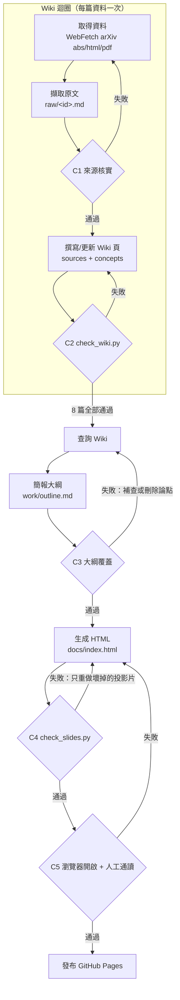
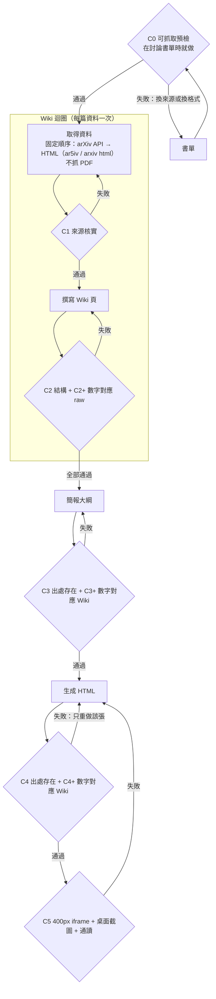

# Workflow：RAG LLM Wiki → 教學簡報

LLM 節點（擷取、撰寫、生成）由 Claude Code 執行；檢查節點 C2／C3／C4 是 `scripts/` 下可重跑的 Python 腳本，原始輸出存在 `runs/`，結論寫入 [log.md](log.md)。

## v1（初版）

### 檢查定義

| 節點 | 檢查內容 | 執行方式 |
|---|---|---|
| C1 來源核實 | 抓到頁面的標題／作者／年份與書單一致，且擷取文字非空 | 人工比對，記錄於 raw/ 與 log |
| C2 Wiki 結構 | frontmatter 欄位齊全；`sources` 指向存在的 source 頁；`[[slug]]` 全部可解析；index.md 列出所有頁面；沒有孤立頁面 | `python scripts/check_wiki.py --root . > runs/<ts>-C2.txt` |
| C3 大綱覆蓋 | 大綱每個論點都標 `src:`，且該 Wiki 頁存在；另做人工語意抽查 | `python scripts/check_slides.py --outline work/outline.md > runs/<ts>-C3.txt` |
| C4 投影片出處 | 每張內容投影片都有 `data-src`，且指向存在的 Wiki 頁；未被引用的概念頁列為 warning | `python scripts/check_slides.py --html docs/index.html > runs/<ts>-C4.txt` |
| C5 實際瀏覽 | 翻頁、版面、手機寬度、新手可讀性 | 瀏覽器開啟 + 人工通讀 |

### 會重複執行的步驟

- Wiki 迴圈：每篇資料跑一次（共 8 次）。
- C1 失敗 → 重抓（abs → html → pdf）。
- C2／C3／C4 失敗 → 修正 → 重跑，直到通過；每一輪都寫入 log。

### 設計理由

- **LLM 寫、腳本查**：生成內容不穩定，檢查必須是可重跑的確定性程式，才能留下可信的紀錄。
- **出處貫穿全程**：source id → Wiki frontmatter → 大綱 `src:` → 投影片 `data-src`，任何一段斷掉，腳本都抓得到，保證簡報對應 Wiki。
- **局部重生**：C4 只重做壞掉的投影片，避免整份重生又引入新錯誤。

## v2（依實際執行紀錄修改）

### v1 執行統計（取自 log.md）

| 節點 | FAIL 次數 | 失敗內容 | 是誰抓到的 |
|---|---|---|---|
| **C1 取得資料** | **3** | WebFetch 不回傳 abstract 原文；http 被轉址回 0 bytes；PDF 只得到二進位 | 人工看輸出 |
| **語意錯誤**（C2／C3 都 PASS） | **2** | 概念頁引用歸屬寫錯；大綱論點引用了不含該內容的頁面 | 臨時腳本與人工抽查，**不是**正式檢查 |
| C5 版面 | 1 | 標籤被裁、出處蓋字（另有 1 次 headless 視窗最小寬度造成的誤判） | 截圖 |
| C2（sources 階段） | 1 | concept 頁尚未建立造成 broken link | 預期內，設計如此 |

**最常出錯的節點是 C1「取得資料」**；**最危險的是語意錯誤**，因為結構檢查全部通過，錯誤會一路流到簡報。

### v2 圖

### 改了什麼、為什麼

| 改動 | 檢查往前移到哪 | 理由 |
|---|---|---|
| 新增 **C0 可抓取預檢**，並把抓取順序固定為 API → HTML、不抓 PDF | 從「ingest 中」移到「**討論書單時**」 | C1 的 3 次失敗都是「格式抓不到」，跟內容無關；在選書階段就能發現，不必等到 ingest 才繞路。v1 計畫寫 abs→html→pdf，實際卻先試 PDF，浪費一輪。 |
| 新增 `scripts/check_claims.py`（C2+／C3+／C4+）：頁面上的數字必須出現在它引用的來源 | 語意檢查從「簡報完成後人工抽查」移到「**撰寫 Wiki 當下**」 | v1 的 C2／C3／C4 只驗「出處檔案存在」，驗不到「出處是否支持這句話」。2 次語意錯誤都是靠臨時檢查才發現。錯誤越早抓，要回頭重做的步驟越少。 |
| 單位換算、示意數字一律用 `<!-- num-ok: … -->` 標註 | — | 讓「刻意的改寫」與「打錯字」可以區分，而且留下可審查的痕跡。 |
| C5 改用 400px iframe 實測 | — | headless 瀏覽器最小視窗寬度約 496px，直接設 400px 會產生誤判。 |

### v2 不處理的事

數字以外的語意（例如「A 優於 B」這類文字主張）仍需人工通讀；check_claims 只保證數字有出處。
