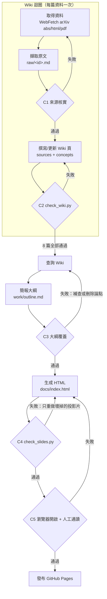

# Workflow：RAG LLM Wiki → 教學簡報

LLM 節點（擷取、撰寫、生成）由 Claude Code 執行；檢查節點 C2／C3／C4 是 `scripts/` 下可重跑的 Python 腳本，原始輸出存在 `runs/`，結論寫入 [log.md](log.md)。

## v1（初版）

### 檢查定義

| 節點 | 檢查內容 | 執行方式 |
|---|---|---|
| C1 來源核實 | 抓到頁面的標題／作者／年份與書單一致，且擷取文字非空 | 人工比對，記錄於 raw/ 與 log |
| C2 Wiki 結構 | frontmatter 欄位齊全；`sources` 指向存在的 source 頁；`[[slug]]` 全部可解析；index.md 列出所有頁面；沒有孤立頁面 | `python scripts/check_wiki.py --root . > runs/<ts>-C2.txt` |
| C3 大綱覆蓋 | 大綱每個論點都標 `src:`，且該 Wiki 頁存在；另做人工語意抽查 | `python scripts/check_slides.py --outline work/outline.md > runs/<ts>-C3.txt` |
| C4 投影片出處 | 每張內容投影片都有 `data-src`，且指向存在的 Wiki 頁；未被引用的概念頁列為 warning | `python scripts/check_slides.py --html docs/index.html > runs/<ts>-C4.txt` |
| C5 實際瀏覽 | 翻頁、版面、手機寬度、新手可讀性 | 瀏覽器開啟 + 人工通讀 |

### 會重複執行的步驟

- Wiki 迴圈：每篇資料跑一次（共 8 次）。
- C1 失敗 → 重抓（abs → html → pdf）。
- C2／C3／C4 失敗 → 修正 → 重跑，直到通過；每一輪都寫入 log。

### 設計理由

- **LLM 寫、腳本查**：生成內容不穩定，檢查必須是可重跑的確定性程式，才能留下可信的紀錄。
- **出處貫穿全程**：source id → Wiki frontmatter → 大綱 `src:` → 投影片 `data-src`，任何一段斷掉，腳本都抓得到，保證簡報對應 Wiki。
- **局部重生**：C4 只重做壞掉的投影片，避免整份重生又引入新錯誤。

## v2

待 v1 執行完後，依 log 統計填入。
